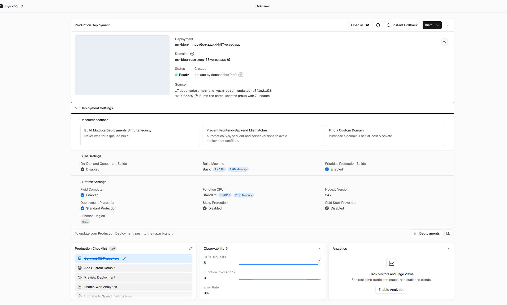

# jsw_blog

我的个人博客，记录技术学习与实践，也记录做项目、寻找实习和生活中的思考。

写博客是为了留下记录，并监督自己持续思考。

> 未来会好吗？会好的。关关难过关关过。

## 记录什么

- Agent、后端开发与 Coding Agent 项目的学习和实践。
- 做项目时遇到的问题、解决方法和心得。
- 寻找实习的经历，以及个人规划、兴趣探索和生活感想。

[在线博客](https://zzzkkkk97-blog.vercel.app/) · [我的 GitHub](https://github.com/zzzkkkk97) · [博客源码](https://github.com/zzzkkkk97/my_blog)

## 技术与功能

博客基于 [Astro](https://astro.build) 和 [Fuwari](https://github.com/saicaca/fuwari) 主题，使用 Svelte、Tailwind CSS 和 Pagefind。

支持 Markdown 写作、标签与分类、文章归档、全文搜索、文章目录、明暗主题和 RSS 订阅。

## 本地运行

准备 Node.js 22 和 pnpm（项目使用 `pnpm@9.14.4`），在项目根目录执行：

```sh
pnpm install
pnpm dev
```

启动后打开终端显示的地址，默认是 `http://localhost:4321`。

## 写文章

```sh
pnpm new-post my-new-post
```

编辑生成的 `src/content/posts/my-new-post.md`：

```markdown
---
title: 我的新文章
published: 2026-10-10
description: 文章摘要
tags: [技术, 学习]
category: 技术笔记
draft: false
---

这里开始写正文。
```

将 `published` 改为实际发布日期。`draft: true` 的文章在本地开发时可见，正式构建时会隐藏；发布前改为 `false`。

## 常用命令

| 命令 | 用途 |
| --- | --- |
| `pnpm dev` | 本地开发和实时预览 |
| `pnpm new-post <文件名>` | 创建文章 |
| `pnpm check` | 检查类型和 Astro 文件 |
| `pnpm build` | 构建静态网站并生成搜索索引，输出到 `dist/` |
| `pnpm preview` | 预览已构建的网站 |

## 项目结构

| 路径 | 内容 |
| --- | --- |
| `src/config.ts` | 站点名称、个人资料、导航和主题配置 |
| `src/content/posts/` | 博客文章 |
| `src/content/spec/about.md` | 关于我页面 |
| `src/content/参考/` | 保留的 Markdown 写作示例 |
| `src/assets/images/` | 头像及其他图片 |
| `public/favicon/` | 网站图标 |
| `astro.config.mjs` | 正式网址、部署路径及构建配置 |

## 部署到 Vercel

在 Vercel 中导入本仓库，使用以下配置：

| 设置 | 值 |
| --- | --- |
| Framework Preset | `Astro` |
| Install Command | `pnpm install --frozen-lockfile` |
| Build Command | `pnpm build` |
| Output Directory | `dist` |

博客正式地址为 https://zzzkkkk97-blog.vercel.app/ 。`astro.config.mjs` 中的站点配置应为：

```js
site: "https://zzzkkkk97-blog.vercel.app/",
base: "/",
```

更换域名时，同步更新 `site`，随后提交并推送修改。

关联 GitHub 后，推送到配置的生产分支会触发 Vercel 自动部署。上线后检查文章、搜索和 `/rss.xml`。

## 致谢与许可

感谢 [Fuwari](https://github.com/saicaca/fuwari) 提供博客主题。项目保留原有 [MIT LICENSE](./LICENSE)；文章授权设置见 `src/config.ts` 中的 `licenseConfig`，当前为 CC BY-NC-SA 4.0。

